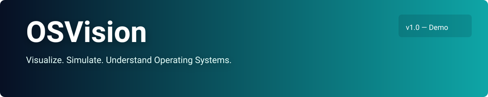

 <p align="center">
  
</p>

<h1 align="center">OSVision</h1>

<p align="center">
  <strong>Interactive Operating Systems Simulator</strong><br>
  <em>Visualize. Simulate. Understand Operating Systems.</em>
</p>

<p align="center">
  
  
  
</p>

<p align="center">
  Explore CPU Scheduling · Analyze Performance · Understand Deadlocks · Simulate Resource Allocation
</p>

---

## 📑 Table of Contents

- [Overview](#-overview)
- [Problem Statement](#-problem-statement)
- [Objectives and Features](#-objectives-and-features)
- [Technology Stack](#️-technology-stack)
- [System Architecture](#️-system-architecture)
- [Getting Started](#-getting-started)
- [Testing and Development Roadmap](#-testing-and-development-roadmap)
- [Limitations and Future Scope](#️-limitations-and-future-scope)
- [Contributing](#-contributing)
- [Project Information](#-project-information)

## 🌟 Overview

**OSVision** is a browser-based educational simulator designed to make Operating Systems concepts easier to understand through interactive visualizations and practical simulations.

The project aims to help students explore CPU scheduling algorithms, analyze process performance, understand deadlocks, and simulate resource allocation. Visual tools such as Gantt charts, process tables, performance graphs, and event logs will connect theoretical concepts with practical learning.

OSVision is intended for computer science students, educators, and anyone interested in learning Operating Systems.

> OSVision is an educational simulator, not a real operating system kernel.

## ❓ Problem Statement

Operating Systems concepts can be challenging to understand through textbooks and static examples alone. Students often find it difficult to visualize process execution, understand preemption, calculate scheduling metrics, and analyze resource allocation or deadlock scenarios.

OSVision aims to address these challenges through an interactive learning environment that presents algorithm execution, calculations, and system states visually.

## 🎯 Objectives and Features

### 1. CPU Scheduling Simulator

The simulator is designed to demonstrate four fundamental CPU scheduling algorithms.

| Algorithm | Scheduling Type | Purpose |
|---|---|---|
| First Come, First Served (FCFS) | Non-preemptive | Executes processes in arrival order |
| Shortest Job First (SJF) | Non-preemptive | Selects the shortest available CPU burst |
| Shortest Remaining Time First (SRTF) | Preemptive | Selects the process with the shortest remaining time |
| Round Robin (RR) | Preemptive | Allocates CPU time using a configurable time quantum |

Users will be able to configure process IDs, arrival times, burst times, and the Round Robin time quantum to explore scheduling behavior.

### 2. Gantt Charts and Execution Visualization

Gantt charts will display process execution intervals, completion times, idle periods, and preemption boundaries.

Planned interactive controls include play, pause, step-by-step execution, and reset. An event log will help explain scheduling decisions and ready-queue changes.

### 3. Performance Analysis

OSVision will calculate and present important scheduling metrics.

| Metric | Formula |
|---|---|
| Turnaround Time (TAT) | Completion Time − Arrival Time |
| Waiting Time (WT) | Turnaround Time − Burst Time |
| Response Time (RT) | First Start Time − Arrival Time |
| CPU Utilization | Busy Time ÷ Total Time × 100% |
| Throughput | Completed Processes ÷ Elapsed Time |

Average waiting time, turnaround time, and response time will support algorithm comparisons. Context switches, preemption counts, and idle time may also be included.

### 4. Algorithm Comparison

Users will be able to evaluate different scheduling algorithms using the same process workload.

Comparative charts and performance summaries will illustrate how algorithm selection affects execution and scheduling metrics. Results will depend on the workload and the performance measure being considered.

### 5. Deadlock Simulator

The deadlock module will demonstrate how processes compete for limited resources.

Planned functionality includes configuring resource availability, allocations, requests, and releases, along with visualizing resource relationships and identifying circular waits in suitable scenarios.

### 6. Banker's Algorithm

The Banker's Algorithm module will demonstrate deadlock avoidance by checking whether a resource-allocation state is safe.

**Need Matrix = Maximum Matrix − Allocation Matrix**

The simulator will display:

- Available resource vector
- Allocation, Maximum, and Need matrices
- Safe sequence, when one exists
- Safe or unsafe state
- Resource-request validation

An unsafe state does not necessarily mean that a deadlock has already occurred.

### 7. Reports and Visualizations

Planned reporting features include:

- Interactive Gantt charts
- Process tables and scheduling metrics
- Performance comparison graphs
- Resource-allocation matrices
- Step-by-step execution logs
- CSV export for supported results

## 🛠️ Technology Stack

| Technology | Purpose |
|---|---|
| React | User interface and reusable components |
| TypeScript | Application and simulation logic |
| Vite | Development server and build tool |
| HTML and CSS | Structure, layout, and styling |
| Vitest | Unit testing |
| React Testing Library | Interface and interaction testing |
| npm | Package management |
| Git and GitHub | Version control and collaboration |

The intended initial release uses browser-based simulation logic and free development tools. A database or backend server is not required for the core simulations.

## 🏗️ System Architecture

OSVision is designed around four logical layers.

```text
┌──────────────────────────────────────┐
│          Presentation Layer          │
│      React UI · Forms · Charts       │
├──────────────────────────────────────┤
│          Simulation Engine           │
│  FCFS · SJF · SRTF · Round Robin     │
│   Deadlock · Banker's Algorithm      │
├──────────────────────────────────────┤
│        Metrics and Analysis          │
│  Waiting · Turnaround · Response     │
│  Utilization · Throughput · Reports  │
├──────────────────────────────────────┤
│      State and Validation            │
│  Input Checks · Events · Error       │
│  Handling · Simulation State         │
└──────────────────────────────────────┘
```

The simulation engine will remain independent of the user interface so that algorithms can be tested separately. Input validation and consistent state handling will support predictable and reproducible results.

## 💻 Getting Started

### Prerequisites

Install the following tools before starting:

- [Node.js](https://nodejs.org/) — includes npm
- [Git](https://git-scm.com/)
- [Visual Studio Code](https://code.visualstudio.com/) or another code editor
- A modern web browser

### Installation

Clone the repository and install the dependencies:

```bash
git clone https://github.com/haidrerDroid/OSVision.git
cd OSVision
npm install
npm run dev
```

Open the local development URL displayed in the terminal.

### Build and Test

```bash
npm run build
npm run test
```

These commands assume the corresponding npm scripts are configured in `package.json`. The test command may need adjustment if the repository uses a different script name.

## 🧪 Testing and Development Roadmap

Testing will focus on algorithm correctness, edge cases, input validation, and interface behavior.

### Testing Priorities

- **CPU Scheduling:** Simultaneous arrivals, idle periods, equal burst times, preemption, and different Round Robin time quanta.
- **Performance Metrics:** Completion, turnaround, waiting, and response times, along with utilization and throughput.
- **Deadlocks:** Resource contention, circular waits, and resource availability changes.
- **Banker's Algorithm:** Safe and unsafe states, multiple safe sequences, invalid matrices, and invalid requests.
- **User Interface:** Invalid inputs, reset behavior, and repeatable simulations.

### Development Roadmap

- [ ] Initialize React, TypeScript, and Vite.
- [ ] Develop the dashboard and reusable interface components.
- [ ] Implement and test FCFS, SJF, SRTF, and Round Robin.
- [ ] Add Gantt charts, process tables, and execution controls.
- [ ] Implement performance metrics and algorithm comparisons.
- [ ] Develop deadlock scenarios and resource visualizations.
- [ ] Implement Banker's Algorithm and safe-sequence detection.
- [ ] Complete testing, documentation, and deployment.

*Roadmap items describe planned work and should be updated as implementation progresses.*

## ⚠️ Limitations and Future Scope

OSVision uses simplified educational models and does not execute as a real operating system. Its initial scope excludes kernel-level execution, hardware interrupts, multicore scheduling, virtual memory management, I/O scheduling, and production synchronization mechanisms.

Potential future enhancements include:

- Priority and multilevel queue scheduling
- Multilevel Feedback Queue scheduling
- Semaphores, mutexes, and classical synchronization problems
- FIFO, LRU, and Optimal page replacement
- First Fit, Best Fit, and Worst Fit memory allocation
- FCFS, SSTF, SCAN, and C-SCAN disk scheduling
- Guided tutorials, quizzes, and downloadable experiment reports

## 🤝 Contributing

Suggestions, bug reports, test cases, documentation improvements, and new educational modules are welcome.

1. Fork the repository.
2. Create a feature branch.
3. Implement and test your changes.
4. Submit a pull request describing your contribution.

Please verify algorithm implementations against known examples before submitting changes.


<p align="center">
  <em>Visualize. Simulate. Understand.</em>
</p>

## 🎓 Project Information

**Project Title:** OSVision — Interactive Operating Systems Simulator

- **Project Type:** Minor Project
- **Project Date:** 18 October 2026

This project aims to make Operating Systems concepts more accessible through interactive simulation, visual analysis, and practical experimentation.

---

<p align="center">
  <strong>OSVision — Visualize. Simulate. Understand Operating Systems.</strong><br>
  Built to make Operating Systems concepts visible, interactive, and easier to understand.
</p>
